# Manual de usuario · Quadro

Quadro ayuda a los integrantes de un emprendimiento a llevar en un solo lugar los gastos que pagan entre todos. Registras quién pagó, cómo se reparte el gasto, y Quadro calcula cuánto aportó cada persona, cuánto le corresponde y quién le debe a quién.

Las imágenes de este manual son capturas reales de la aplicación, tomadas durante las pruebas automáticas con un grupo de ejemplo: Ana (administradora), Bruno y Carla, del emprendimiento "Arepas La Esquina".

## Antes de empezar

- Funciona en el navegador del computador o del celular (Chrome, Edge o Firefox actualizados). No hay que instalar nada.
- Cada persona necesita su propia cuenta.
- Los valores se escriben en pesos colombianos, sin centavos.

Palabras que verás en la aplicación:

| Palabra | Significado |
|---|---|
| Grupo | El emprendimiento o equipo que comparte gastos |
| Administrador | Quien creó el grupo. Agrega o retira integrantes y administra las categorías |
| Integrante | Persona que pertenece al grupo |
| Reparto | Cómo se divide un gasto entre los integrantes |
| Saldo | Lo que pagaste menos lo que te corresponde. Positivo: el grupo te debe. Negativo: tú debes |
| Liquidación | Un pago entre dos integrantes para saldar una deuda |

## 1. Crear tu cuenta

1. Entra a Quadro y elige **Regístrate gratis**.
2. Escribe tu nombre, tu correo y una contraseña de al menos 8 caracteres con letras y números.
3. Pulsa **Crear cuenta**. Entrarás directamente a la aplicación.

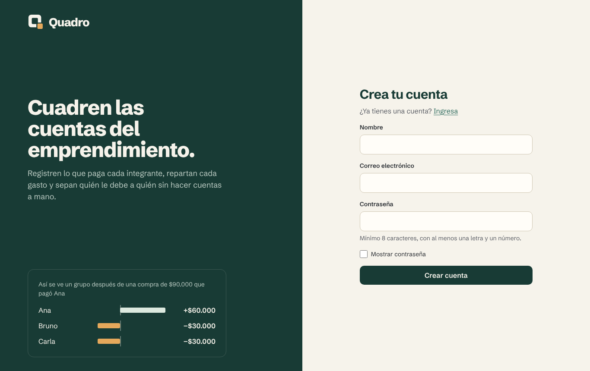

Si falta un dato o no es válido, Quadro te lo indica debajo de cada campo:

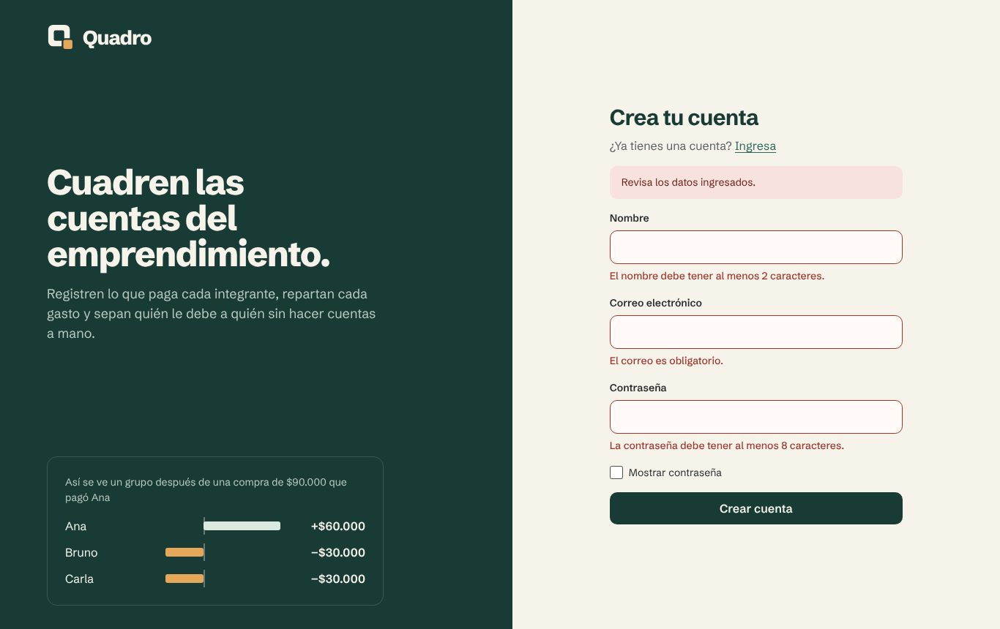

## 2. Ingresar y salir

1. En **Ingresa a Quadro**, escribe tu correo y tu contraseña y pulsa **Ingresar**.
2. Si los datos no coinciden, verás "Correo o contraseña incorrectos." Revisa que el correo esté bien escrito. Puedes marcar **Mostrar contraseña** para comprobarla.
3. Para salir, pulsa el ícono de salida junto a tu nombre, abajo en el menú lateral.

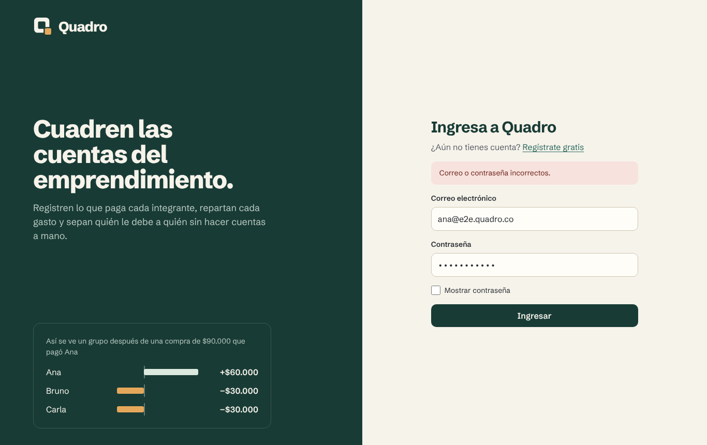

Por seguridad, la sesión dura 8 horas. Si vence, Quadro te pedirá ingresar de nuevo.

## 3. Mis grupos

Al ingresar ves **Mis grupos**: los grupos en los que participas, cuánto se ha gastado en cada uno y tu saldo. Si todavía no tienes grupos, Quadro te invita a crear el primero.

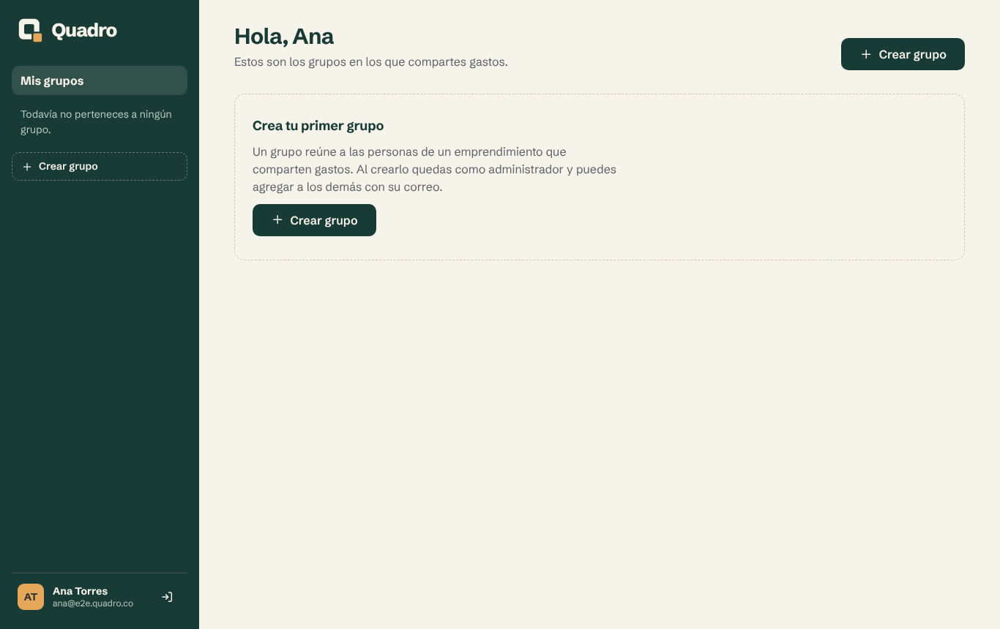

## 4. Crear un grupo

1. Pulsa **Crear grupo**.
2. Escribe el nombre del emprendimiento (mínimo 3 caracteres) y, si quieres, una descripción.
3. Pulsa **Crear grupo**. Quedarás como administrador y Quadro te llevará a la pestaña **Integrantes**.

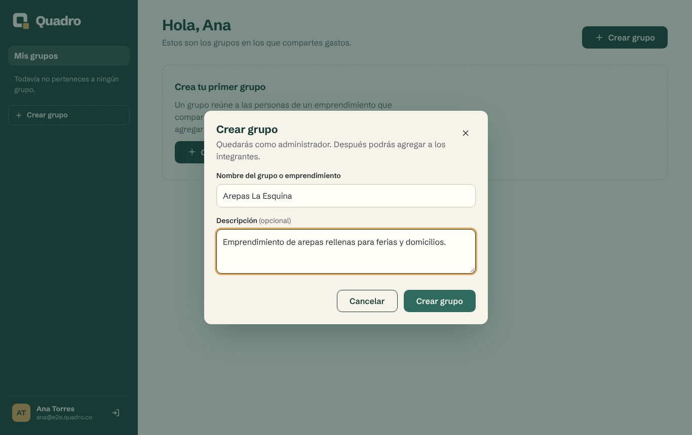

Cada grupo nuevo trae las categorías Materia prima, Insumos, Transporte, Herramientas, Servicios y Otros. Para cambiar el nombre o la descripción, el administrador pulsa **Editar grupo**.

## 5. Agregar o retirar integrantes

Solo el administrador puede hacerlo.

1. Abre la pestaña **Integrantes**.
2. Pide a la persona que cree su cuenta en Quadro. Luego escribe ese mismo correo en **Correo de su cuenta en Quadro**.
3. Pulsa **Agregar integrante**. Desde ese momento la persona verá el grupo.

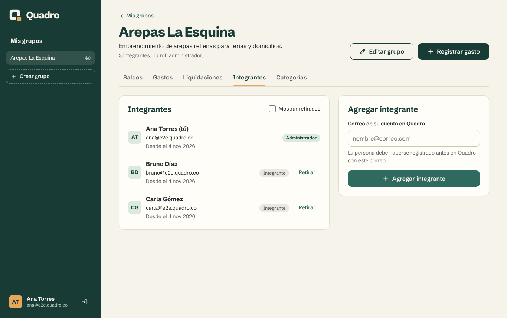

Para retirar a alguien, pulsa **Retirar** junto a su nombre y confirma. Solo se puede retirar a quien no tiene deudas pendientes. Su historial se conserva y puedes ver a los retirados marcando **Mostrar retirados**.

## 6. Registrar un gasto

Cualquier integrante puede registrar gastos.

1. Pulsa **Registrar gasto** (arriba a la derecha en el grupo).
2. Completa **Descripción**, **Importe**, **Fecha**, **Categoría** y **¿Quién pagó?**. La fecha no puede ser posterior a hoy.
3. En **¿Cómo se reparte?** elige el método y marca a los integrantes que participan.
4. Revisa la vista previa: al lado de cada nombre aparece lo que le corresponde y abajo se confirma que el reparto suma el importe.
5. Pulsa **Registrar gasto**.

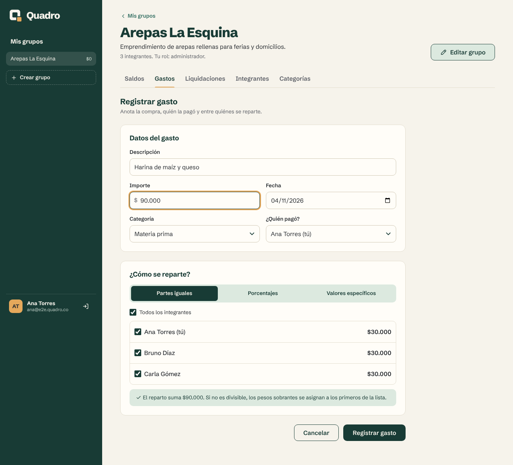

### Los tres métodos de reparto

- **Partes iguales:** el importe se divide entre los participantes. Si no es exacto, los pesos sobrantes se asignan a los primeros de la lista. Por ejemplo, $100.000 entre 3 queda en $33.334, $33.333 y $33.333.
- **Porcentajes:** escribe el porcentaje de cada persona; deben sumar 100 %. El botón **Repartir 100 % por igual** los completa por ti.
- **Valores específicos:** escribe cuánto le corresponde a cada persona; la suma debe ser igual al importe.

Si los porcentajes o los valores no cuadran, Quadro lo avisa y no guarda el gasto:

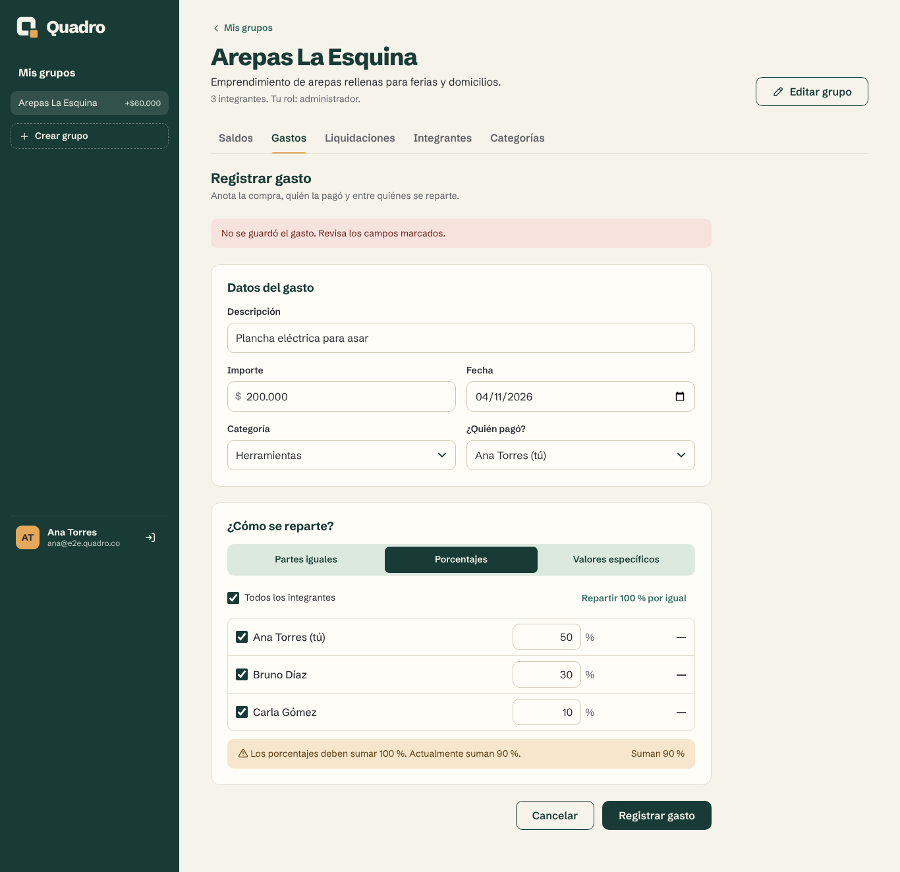

Al corregirlos, la vista previa muestra el resultado:

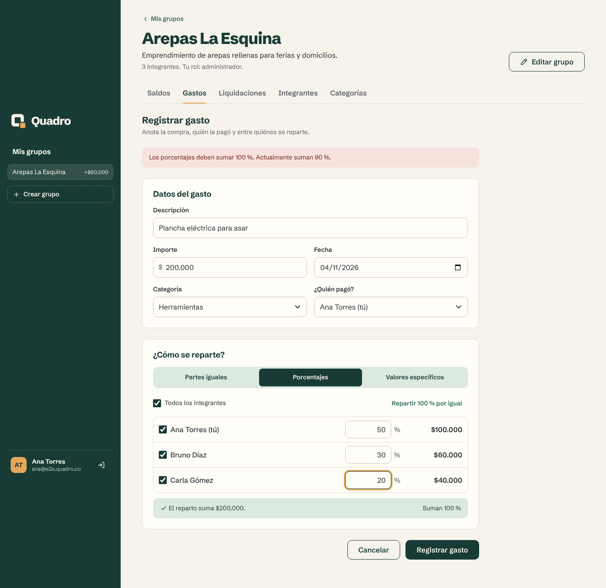

## 7. Consultar el historial de gastos

La pestaña **Gastos** muestra todos los gastos del grupo, del más reciente al más antiguo, con quién pagó, la categoría, el importe y **Tu parte**.

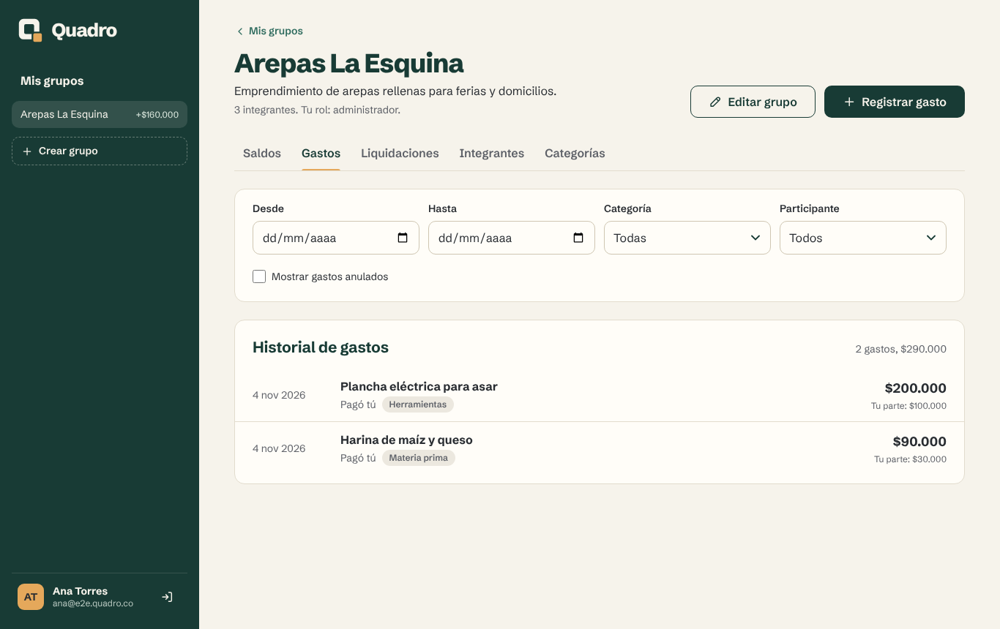

Para buscar gastos usa los filtros **Desde**, **Hasta**, **Categoría** y **Participante**. Se aplican al momento. **Limpiar filtros** vuelve a mostrar todo y **Mostrar gastos anulados** incluye los anulados.

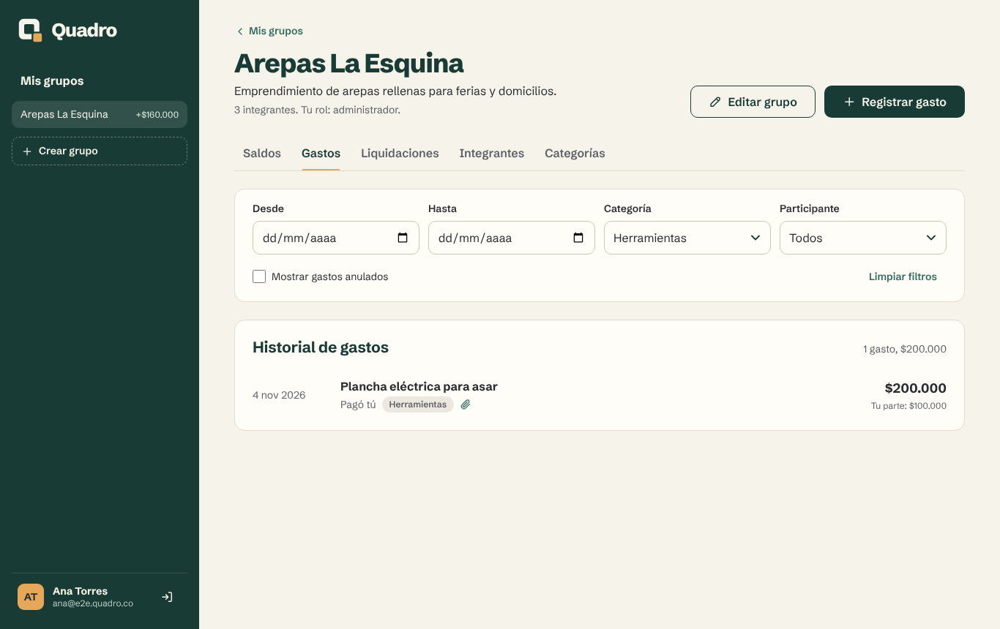

## 8. Ver el detalle de un gasto y adjuntar comprobantes

Pulsa un gasto del historial para ver su detalle: fecha, quién pagó, categoría, método, quién lo registró y cuánto le corresponde a cada persona.

Para guardar el recibo o la factura:

1. En **Comprobantes**, pulsa **Adjuntar comprobante**.
2. Elige una imagen JPG, PNG o WEBP o un PDF de hasta 2 MB. Cada gasto admite hasta 5.
3. El archivo aparece en la lista. Pulsa su nombre para abrirlo.

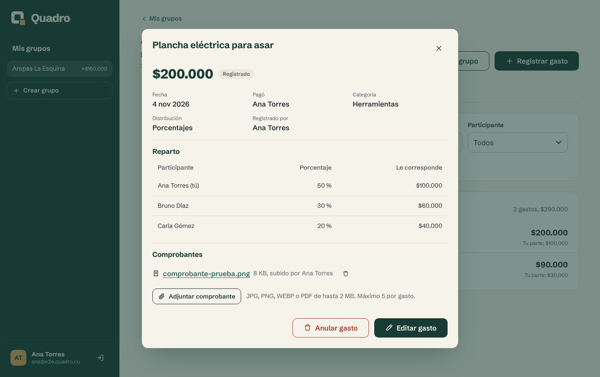

## 9. Editar o anular un gasto

Solo quien registró el gasto o el administrador pueden hacerlo.

- **Editar:** en el detalle, pulsa **Editar gasto**, cambia lo necesario y pulsa **Guardar cambios**. El gasto queda marcado como **Modificado** y los saldos se recalculan.
- **Anular:** en el detalle, pulsa **Anular gasto** y confirma. El gasto deja de contar en los saldos, pero sigue en el historial marcado como anulado.

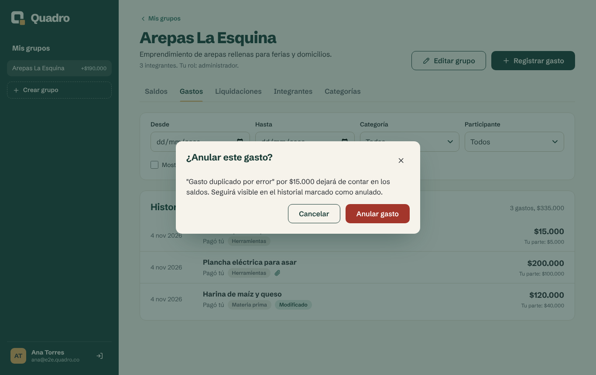

## 10. Consultar saldos y deudas

La pestaña **Saldos** es la primera que se abre en cada grupo.

- **Tu posición** (recuadro verde): dice si el grupo te debe, si le debes o si estás al día, y muestra cuánto pagaste y cuánto te corresponde.
- **Balance del grupo:** una barra por integrante. Hacia la derecha (verde) lo que tiene a favor; hacia la izquierda (ámbar) lo que debe. Cuando nadie debe nada aparece **Cuentas cuadradas**.
- **Deudas pendientes:** quién le debe a quién y cuánto, con el botón **Registrar liquidación**.
- **Resumen del grupo:** total gastado, número de gastos, total liquidado y gasto por categoría.
- **Detalle por integrante:** tabla con lo que pagó, lo que le corresponde, las liquidaciones y el saldo de cada persona.

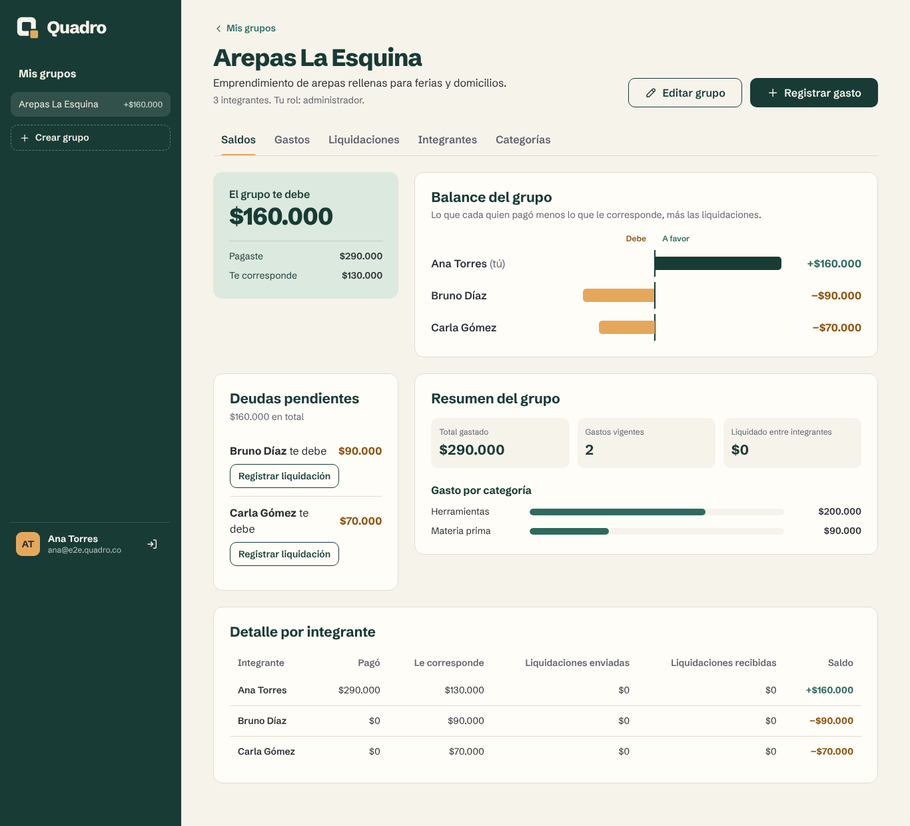

## 11. Registrar una liquidación (pago entre integrantes)

Cuando un integrante le paga a otro lo que le debe:

1. En **Saldos**, pulsa **Registrar liquidación** junto a la deuda. También puedes ir a la pestaña **Liquidaciones**.
2. Revisa **Quién paga** y **Quién recibe**. Quadro muestra la deuda pendiente entre los dos; **Usar el total** la copia en el importe.
3. Escribe el **Importe** (puede ser un pago parcial), la **Fecha** y, si quieres, una **Nota** (por ejemplo, "Transferencia por Nequi").
4. Pulsa **Registrar liquidación**.

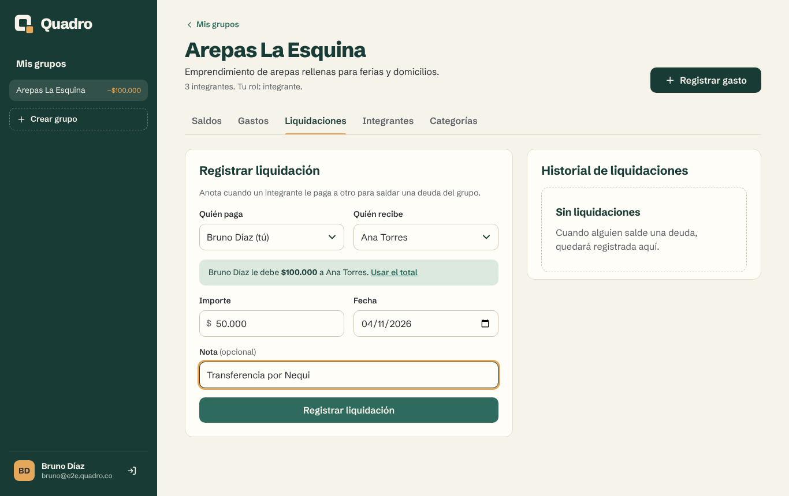

El importe no puede ser mayor que la deuda pendiente. Pueden registrar la liquidación quien paga, quien recibe o el administrador. Si hubo un error, quien la registró o el administrador la puede anular desde el historial.

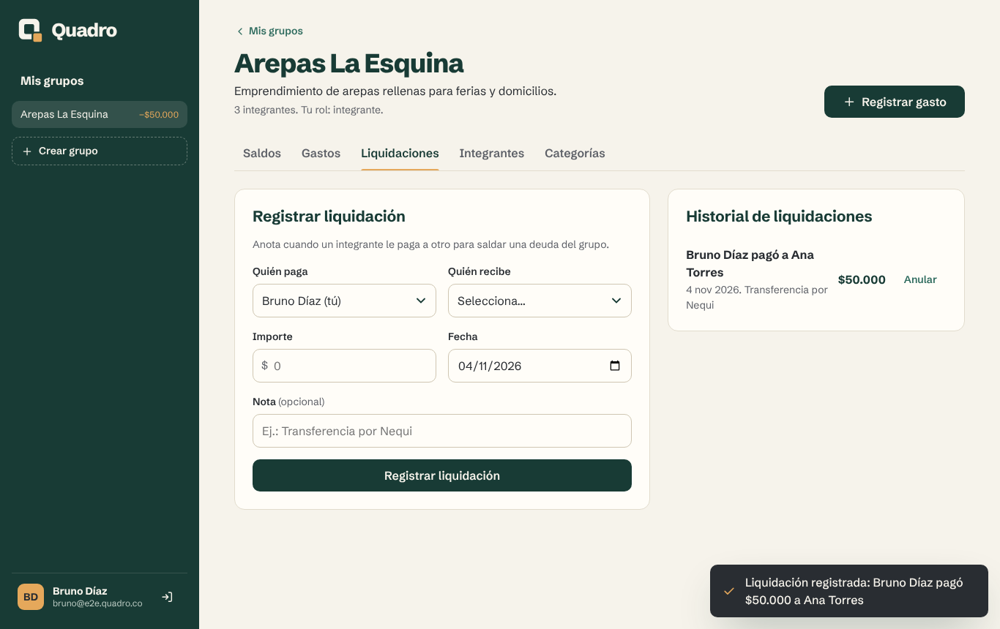

## 12. Administrar categorías

En la pestaña **Categorías** todos ven las categorías y cuántos gastos tiene cada una. El administrador puede:

- Crear una categoría con **Crear categoría** (2 a 40 caracteres, sin repetir nombres).
- Cambiarle el nombre con **Renombrar**.
- Eliminarla con el ícono de papelera, solo si no tiene gastos.

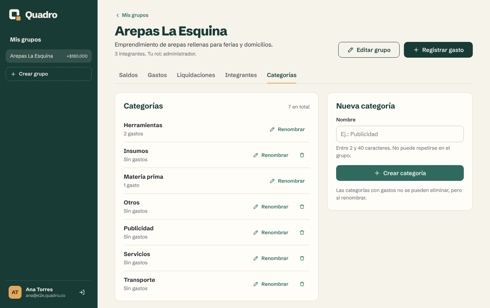

## 13. Usar Quadro en el celular

En pantallas pequeñas el menú se abre con el botón de tres líneas, arriba a la derecha. Allí están tus grupos, **Crear grupo** y el botón para salir. Las demás pantallas se reorganizan en una sola columna.

| Menú | Saldos | Historial de gastos |
|---|---|---|
| 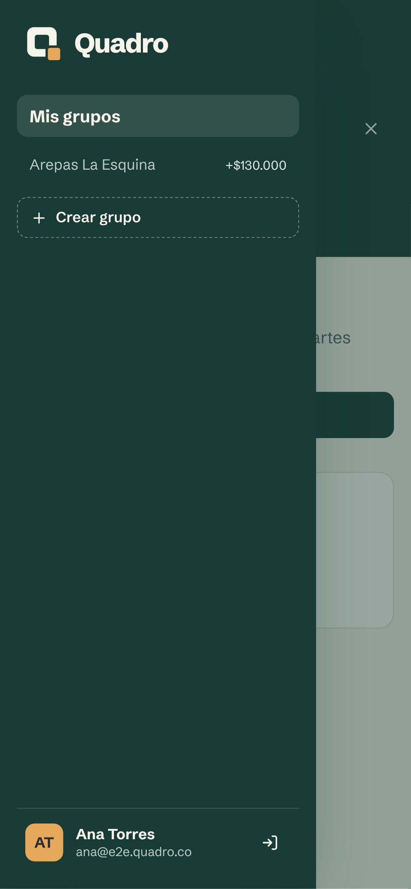 | 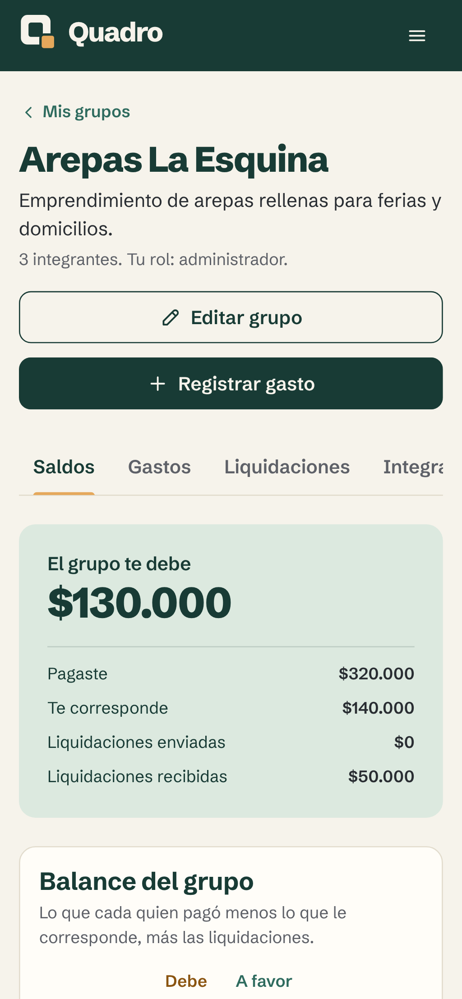 | 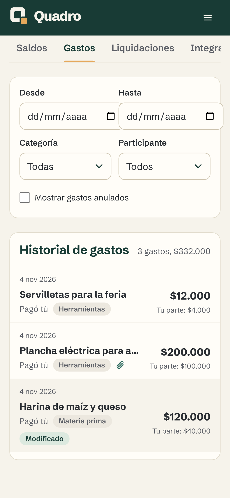 |

## 14. Mensajes frecuentes

| Mensaje | Qué hacer |
|---|---|
| Correo o contraseña incorrectos. | Revisa el correo y la contraseña. Si no tienes cuenta, regístrate |
| Este correo no está registrado en Quadro. | La persona debe crear su cuenta antes de que la agregues |
| Los porcentajes deben sumar 100 %. | Ajusta los porcentajes o usa **Repartir 100 % por igual** |
| La suma de los valores debe ser igual al importe del gasto. | Revisa los valores de cada persona |
| La fecha del gasto no puede ser posterior a hoy. | Usa la fecha real de la compra |
| El importe supera la deuda pendiente. | Registra como máximo lo que se debe |
| Solo quien registró el gasto o el administrador del grupo pueden modificarlo. | Pide el cambio a esa persona o al administrador |
| … tiene cuentas pendientes. Registra las liquidaciones antes de retirarlo. | Salda primero sus deudas desde **Saldos** |
| El archivo supera el tamaño máximo permitido (2 MB). | Reduce la imagen o toma la foto con menor resolución |
| No encontramos este grupo. | No perteneces al grupo o te retiraron. Pide al administrador que te agregue |
